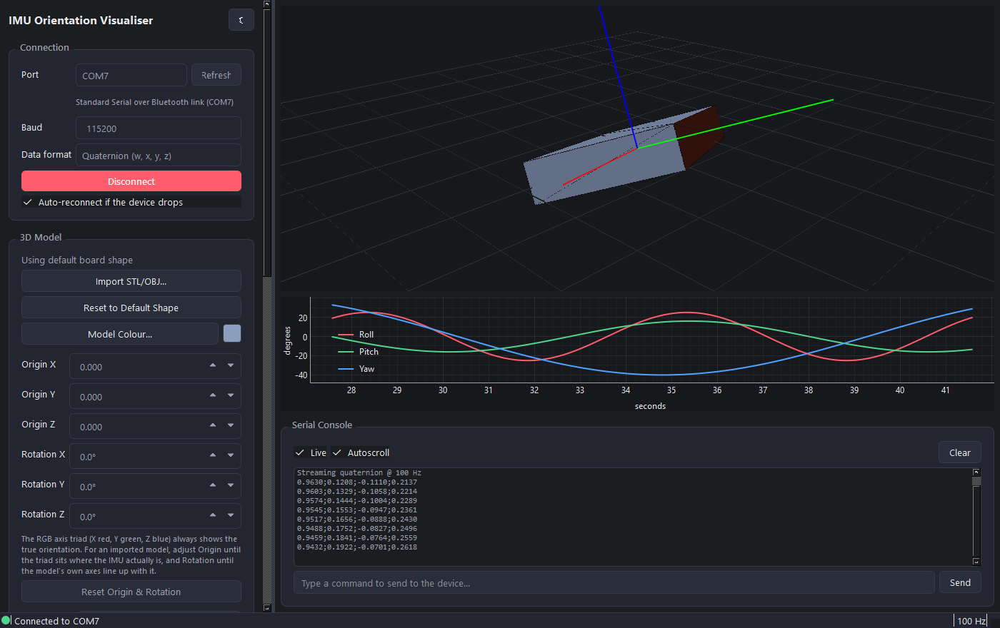
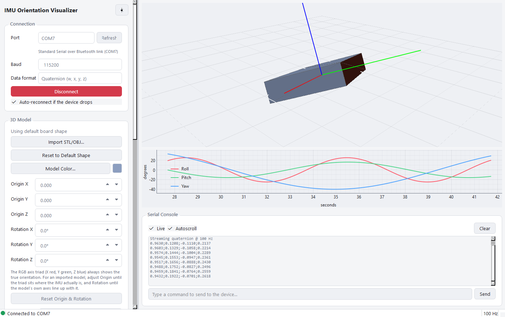

# IMU Orientation Visualizer

A desktop app that reads orientation data from an IMU over a serial port and shows it live in 3D. The IMU (originally an MPU-6050, currently an LSM6DSV16X) sits on an ESP32 or similar microcontroller, which does the angle/quaternion calculation and streams the result over USB serial. This app only receives and renders it.

<p align="center">
  
  
</p>
<p align="center"><sub>Screenshots use simulated data.</sub></p>

## Features

**Connection**
- Pick the COM port and baud rate from dropdowns (with a refresh button), connect and disconnect at any time.
- Choose the incoming format: quaternion (`w;x;y;z`) or Euler angles (`roll;pitch;yaw`, degrees).
- Auto-reconnects if the device resets or is unplugged, and flags the status bar if no data has arrived for a few seconds.
- A serial console shows every raw line from the device (startup messages and debug prints included, not just orientation data) and lets you send commands back.

**3D view**
- GPU-rendered (OpenGL) and smooth-shaded, with an always-true R/G/B = X/Y/Z axis triad.
- Default placeholder board with a highlighted "front" face and adjustable size, or import your own **STL / OBJ** model.
- Model color picker, screenshot export, and a camera reset.
- Live quaternion and Euler readouts (both are always shown, whichever format you are receiving) plus a rolling 15 s roll/pitch/yaw graph.

**Calibration** (see [Aligning the model](#aligning-the-model-to-the-sensor) below)
- Axis remap for sensors mounted sideways or upside-down.
- Model origin and rotation, so an imported model pivots about the real IMU position with its axes lined up.
- Tare ("Set Zero") to zero out a mounting offset.

**Recording and playback**
- Record a session to CSV, then replay it later through the same view with no hardware attached. Useful for debugging intermittent problems.

**Everything else**
- Light and dark themes (toggle in the top-right of the left panel).
- Remembers your port, baud, format, axis remap, model, origin/rotation, board size, color and theme between runs.

## Getting started

Requires Python 3.10 or newer (developed on 3.14). Developed and tested on Windows; the code is plain PySide6 and pyserial, but it has not been tried on other platforms.

Double-click `run.bat`, or run it from a terminal. The first run creates a `.venv` and installs the dependencies; after that it just launches the app.

To set it up manually instead:

```sh
python -m venv .venv
.venv\Scripts\pip install -r requirements.txt
.venv\Scripts\python main.py
```

Then pick your COM port and baud rate, choose the data format your firmware sends, and press **Connect**.

## Serial data format

One reading per line. Fields can be separated by `;`, `,` or whitespace.

| Mode | Line | Notes |
| --- | --- | --- |
| Quaternion | `w;x;y;z` | Normalized on receipt. |
| Euler | `roll;pitch;yaw` | Degrees. Applied as `R = Rz(yaw) · Ry(pitch) · Rx(roll)`. |

Any line that does not have the expected number of numeric fields is ignored for orientation purposes but still appears in the serial console, so boot messages and debug output are fine.

The app works with any firmware that prints these lines (for example, `Serial.println` of the values joined with `;`). Set the baud rate in the app to match your firmware.

## Aligning the model to the sensor

Three separate tools deal with orientation, and they do different jobs:

| Tool | What it changes | Use it when |
| --- | --- | --- |
| **Axis remap** | The incoming sensor data, before anything else. | The sensor is physically mounted rotated relative to the body you are visualizing, so the motion itself is wrong. |
| **Origin / Rotation** (imported models only) | How the model sits relative to the triad. The triad is not affected. | The motion is correct, but the STL/OBJ rotates about the wrong point, or its own baked-in axes do not match the sensor's. |
| **Tare** | The zero reference: the current pose becomes 0, 0, 0 for display. | You just want "wherever it is right now" to be the starting point. |

The axis triad always shows the true orientation: X red, Y green, Z blue. The remap dropdowns are colored the same way. For an imported model, nudge **Origin** until the triad sits where the IMU actually is on the part, then adjust **Rotation** until the model's axes line up with the triad.

Imported models are auto-centered and scaled to fit the view. OBJ support covers geometry only (vertices and faces, with polygons split into triangles); materials and textures are ignored.

## Recording and playback

**Start Recording** writes a CSV with one row per incoming sample:

```
t,w,x,y,z,roll_deg,pitch_deg,yaw_deg
```

`t` is seconds since recording started. Recordings capture the orientation after axis remap but before tare. **Load Log for Playback** replays a file at its original timing through the same 3D view, plot and readouts. Playback and a live connection are mutually exclusive.

## Project layout

```
main.py              Entry point
run.bat              One-click launcher (creates the venv on first run)
requirements.txt
imuviz/
  main_window.py     UI and application logic
  viewport.py        OpenGL scene: board/model, axis triad, shading
  serial_worker.py   Background serial reader and writer
  orientation_math.py  Quaternion / Euler / rotation-matrix conversions
  model_loader.py    STL and OBJ import
  recorder.py        CSV session recording
  playback.py        CSV session playback
  theme.py           Light and dark palettes
  settings.py        Persistent settings (QSettings)
docs/                README screenshots
legacy/              Original matplotlib scripts (see below)
```

Settings are stored with `QSettings`, which on Windows means the registry under `HKEY_CURRENT_USER\Software\IMUViz\AccelerometerPlotter`.

## Legacy scripts

`legacy/animation_quaternion.pyw`, `legacy/animation_quaternion_old.pyw` and `legacy/3dcuberotateanim.py` are the original matplotlib versions: one hardcoded COM port and no UI. The two quaternion scripts also used a pitch formula that drifted at larger angles, which is fixed in the current app. They are kept for reference, along with their `legacy/lib/` helpers and `legacy/test.py` raw-serial probe. Use `main.py` instead.
