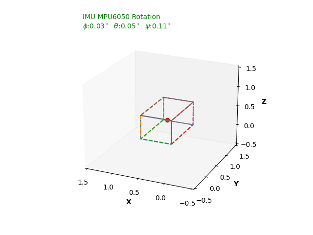

This repo reads orientation data from an IMU (originally an MPU-6050, currently an LSM6DSV16X) on an ESP32/microcontroller, sent over Serial USB, and visualizes it live in 3D. Angle/quaternion computation happens on the microcontroller; this Python app just receives and renders it.

<p align="center">
  
</p>

## IMU Orientation Visualizer (`main.py`)

A proper desktop app (PySide6 + OpenGL via pyqtgraph) with:

- Dynamic serial port selection, baud rate, connect/disconnect, and **auto-reconnect** if the device resets or unplugs — no more hardcoded `COM17` and restarting the script per port.
- Switchable input format: quaternion (`w;x;y;z`) or Euler angles (`roll;pitch;yaw`), matching whatever your firmware sends.
- A live-rotating, smooth-shaded 3D view of either a default placeholder board (size-adjustable, with a highlighted "front" face so orientation is unambiguous) or your own imported **STL/OBJ model**, with an adjustable origin/pivot so the model rotates around where the IMU actually sits rather than its geometric centroid.
- **Axis remap**: correct a sensor mounted sideways/upside-down/rotated relative to the visualized body, without re-flashing firmware.
- Live quaternion + Euler readouts (computed both ways regardless of input format), a rolling roll/pitch/yaw graph, and a two-way serial console (view MCU debug output, send commands back) with a stale-data warning if the device stops sending.
- **Record & playback**: log a live session to CSV with timestamps, then replay it through the same 3D view later without hardware attached — handy for debugging intermittent issues.
- "Set Zero (Tare)" to zero out a mounting offset instead of re-flashing firmware, and one-click screenshot export of the 3D view.
- Remembers your settings (port, baud, mode, model, axis remap, board size) between runs.

### Running

Double-click `run.bat` (or run it from a terminal). First run sets up `.venv` and installs dependencies automatically; after that it just launches the app.

To run manually instead:

```sh
python -m venv .venv
.venv\Scripts\pip install -r requirements.txt
.venv\Scripts\python main.py
```

Then in the app: pick your COM port and baud rate, choose whether your firmware sends quaternions or Euler angles, and hit **Connect**.

### Firmware

Flash `GetAngle_MPULIGHT/GetAngle_MPULIGHT.ino` to an ESP32 wired to an MPU6050 (using the [MPU6050_light](https://github.com/rfetick/MPU6050_light) library) to stream Euler angles (`roll;pitch;yaw`). If your firmware streams quaternions instead (`w;x;y;z`, one per line, semicolon-separated), just switch the app's data format to Quaternion — no code changes needed.

## Legacy scripts

`legacy/animation_quaternion.pyw`, `legacy/animation_quaternion_old.pyw`, and `legacy/3dcuberotateanim.py` are the original matplotlib-based, single-COM-port, quaternion-or-Euler-only versions, kept for reference along with their `legacy/lib/` helper modules and `legacy/test.py` raw-serial probe. Prefer `main.py` — it does everything they did plus dynamic port/mode switching, model import, and a much faster OpenGL renderer.
